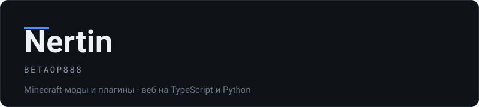

  

Владелец и единственный разработчик **EssentialCrack** — форка клиента Essential для Minecraft. Пишу моды и плагины для игры, параллельно делаю веб: в основном TypeScript, Next.js и Python.

- [X](https://x.com/nertinzxc) — @nertinzxc
- [Discord](https://discord.gg/essentialcrack) — сервер EssentialCrack

## Стек

Доли языков посчитаны по байтам кода во всех репозиториях аккаунта, включая приватные. Имена репозиториев не публикуются.

<picture>
  <source media="(prefers-color-scheme: dark)" srcset="assets/langs-dark.svg">
  
</picture>
