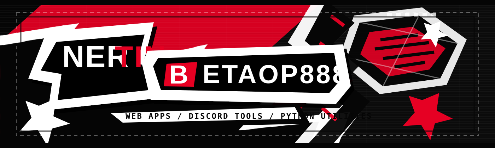

  

  
  
  

## Привет, я nertin

Делаю сайты, небольшие веб-приложения и инструменты под конкретные задачи. Чаще всего работаю с проектами для Discord/Minecraft-сообществ: авторизация, админки, каталоги, голосования, простые панели и полезные утилиты.

Мне нравится собирать не просто красивую страницу, а вещь, которой реально можно пользоваться: зайти, нажать, создать заявку, найти цену, проголосовать, настроить мод или быстро получить нужную информацию.

## Стек

  
  
  
  
  
  
  
  

## Проекты

| Проект | Что внутри | Стек |
| --- | --- | --- |
| Minify Dota 2 | Локальный инструмент для установки набора Dota 2-модов, которые упрощают визуальные эффекты и помогают с FPS. | Python, Tkinter |

## Что я обычно собираю

- веб-приложения для игровых и Discord-сообществ;
- авторизацию через Discord OAuth;
- админ-панели, роли, заявки, каталоги и голосования;
- простые интерфейсы, где важнее удобство, чем лишний шум;
- Python-скрипты и небольшие desktop-утилиты.

## Сейчас

- улучшаю свои проекты и довожу их до более аккуратного состояния;
- разбираюсь глубже в Next.js, базах данных и деплое;
- собираю портфолио из реальных задач, а не учебных заглушек.

## Статистика

  
  

  

## Связь

Писать можно в Telegram: [t.me/+Lho6vMu9wGEyYjYy](https://t.me/+Lho6vMu9wGEyYjYy)
